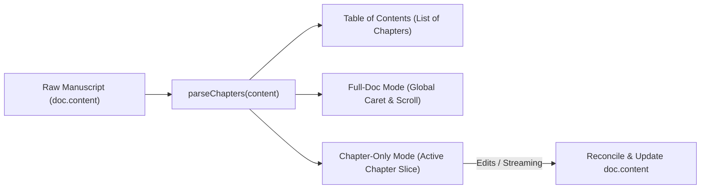

# Chapter Management Implementation Plan & Checklist

This plan details the architecture, design choices, and phase-by-phase implementation checklist for adding full Chapter support to **PairQuill**.

---

## 1. Architectural Strategy & Design Choices

### Core Principle: Plain-Text Compatibility
PairQuill's foundational principle is plain-text document sovereignty:
* Stories are stored as standard UTF-8 strings in IndexedDB and exported/imported as `.txt` and `.json`.
* Rather than splintering `StoryDoc.content` into rigid nested database models, chapters are parsed dynamically from the manuscript text using standard, universally recognizable Markdown headers (`# Chapter Title` or `## Chapter Title`).
* **Benefits**:
  * 100% backward and forward compatibility with existing `.txt` and `.json` files.
  * Zero database migrations or breaking changes to existing stories.
  * Works naturally if an author imports a manuscript from external software.



---

## 2. Chapter Data Model

A new utility module `src/lib/chapters.ts` will parse and manage chapter segments:

```ts
export interface ChapterInfo {
  id: string              // Deterministic or stable chapter identifier
  index: number           // 0-based index
  title: string           // Clean display title (e.g., "The Lighthouse")
  headerText: string      // Full raw line (e.g., "# Chapter 1: The Lighthouse")
  startIndex: number      // Character offset of header start in doc.content
  bodyStartIndex: number  // Character offset where chapter body starts (after newline)
  endIndex: number        // Character offset where chapter ends (start of next header or EOF)
  wordCount: number       // Word count of chapter body
}
```

### Supported Header Formats
* `# Chapter 1: Custom Name` (Markdown H1)
* `## Chapter 1: Custom Name` (Markdown H2)
* Custom titles without prefix: `# The Gathering Storm`
* Fallback when no headers exist: Implicit single chapter `"Entire Manuscript"`.

---

## 3. Implementation Checklist

### Phase 1: Chapter Parsing & Core Utilities (`src/lib/chapters.ts`)
- [ ] **Header Detection Regex**:
  - Implement parser supporting `# [Title]` and `## [Title]`.
  - Handle multi-line normalization, trailing spaces, and edge cases (e.g. headers inside dialogue or empty titles).
- [ ] **Chapter Boundary Calculation**:
  - Compute `startIndex`, `bodyStartIndex`, and `endIndex` for each chapter.
  - Compute per-chapter word counts using the zero-allocation `wordCount()` scanner.
- [ ] **Content Slicing & Splicing Helpers**:
  - `getChapterSlice(content: string, chapter: ChapterInfo, includeHeader: boolean)`
  - `spliceChapter(content: string, chapter: ChapterInfo, newChapterText: string): string`
  - Ensure zero offset drift when updating text in single-chapter mode.
- [ ] **Unit Tests**:
  - Tests for parsing 0 chapters, 1 chapter, and 20+ chapters.
  - Tests for boundary preservation when adding/deleting text.

---

### Phase 2: "Add Chapter Header" Workflow
- [ ] **Custom Header Insertion Command**:
  - Add `Insert Chapter...` option in the TopBar menu, editor toolbar, and context menu.
  - Shortcut support: <kbd>Ctrl</kbd> + <kbd>Shift</kbd> + <kbd>H</kbd> (or <kbd>⌘</kbd> + <kbd>Shift</kbd> + <kbd>H</kbd>).
- [ ] **Chapter Header Modal / Popover**:
  - Input field for custom chapter title (e.g. `The Crossing`).
  - Optional toggle: Auto-prefix numbering (e.g. `Chapter 3: The Crossing` vs `The Crossing`).
  - Suggested next chapter number based on existing count (`Chapter ${chapters.length + 1}`).
- [ ] **Insertion Execution**:
  - If caret is mid-paragraph, cleanly insert two newlines and the header: `\n\n# Chapter N: Title\n\n`.
  - Place cursor immediately below the new header ready for writing.

---

### Phase 3: Table of Contents (ToC) & Navigation
- [ ] **Table of Contents UI (Drawer / Modal)**:
  - Accessible via top bar icon (<i class="fa-solid fa-list-ol"></i> or <i class="fa-solid fa-book-bookmark"></i>) and shortcut.
  - Shows list of all detected chapters with:
    - Chapter number & custom name.
    - Word count badge per chapter.
    - Relative progress indicator (% of total manuscript).
- [ ] **Hotlink Jump Actions**:
  - **In Full Document Mode**:
    - Clicking a chapter smoothly scrolls the editor to that chapter's header.
    - Sets caret to the start of the chapter body.
    - Briefly flashes/highlights the header line to orient the author.
  - **In Chapter-Only View Mode**:
    - Clicking a chapter switches the active chapter view to the selected chapter.
- [ ] **Empty State Handling**:
  - If no headers exist, display: *"No chapters detected. Add your first chapter header to build an outline."* with a one-click button *"Add Chapter 1"*.

---

### Phase 4: "Show Only Current Chapter" (Chapter Focus Mode)
- [ ] **View Mode State Management**:
  - Add session/doc state:
    - `chapterMode: boolean` (default: `false` = full document).
    - `activeChapterIndex: number` (tracks which chapter is focused).
- [ ] **Editor Viewport Integration (`EditorPane.svelte`)**:
  - **Full Document View (`chapterMode = false`)**:
    - Displays full manuscript as usual.
    - Caret movements update the active chapter indicator in the status bar/top bar.
  - **Single Chapter View (`chapterMode = true`)**:
    - Editor displays only the active chapter's text (`[bodyStartIndex, endIndex]` or including header).
    - Prevents overwhelming scroll distances on 100k+ word manuscripts.
    - Input synchronization: Updates made to the chapter slice are seamlessly spliced into `doc.content`.
- [ ] **Chapter Mode Header Banner & Quick Navigation**:
  - Persistent sticky sub-bar above the editor in Chapter Mode:
    - `◀ Previous Chapter` button (disabled on Chapter 1).
    - Center dropdown / title pill to quickly switch chapters.
    - `Next Chapter ▶` button (or `+ New Chapter` on last chapter).
    - Toggle button to exit back to `Full Document View`.
- [ ] **Status Bar Details**:
  - In Chapter Mode, show: `Chapter: 2,450 words · Story: 45,200 words`.

---

### Phase 5: AI Generation & LLM Context Compatibility
- [ ] **Chapter-Aware Continuation**:
  - When "Continue from cursor" runs in single-chapter mode, enforce that generation remains scoped within the chapter boundaries.
  - Prevent generated text from bleeding past subsequent chapter headers.
- [ ] **Context Window Scoping**:
  - Update `tokens.ts` / `computeBudget()`:
    - Option A: Feed story tail prior to current cursor (standard).
    - Option B: Prioritize current chapter's preceding text + chapter summary before falling back to earlier chapters.
- [ ] **Undo / Retry in Scoped Mode**:
  - Verify that `Ctrl+Shift+Y` (Retry) cleanly replaces text within the chapter slice without corrupting the surrounding document.

---

### Phase 6: Edge Cases, Testing & Verification
- [ ] **Header Renaming / Deletion Edge Cases**:
  - If user edits or deletes `# Chapter 1` directly inside the text editor, gracefully re-parse without crashing or losing caret.
  - If user deletes the currently active chapter in single-chapter mode, automatically fall back to the preceding chapter or full-doc mode.
- [ ] **Single-File Build & Performance**:
  - Verify that chapter parsing runs efficiently without triggering layout thrashing or unneeded re-renders.
  - Ensure bundle size remains compact.
- [ ] **End-to-End Test Suite**:
  - Add Playwright tests in `scripts/verify-ui.mjs` verifying:
    - Adding chapter headers with custom names.
    - Jumping via ToC hotlinks.
    - Toggling Chapter-Only view mode and editing within it.
    - Preserving full document integrity on save/export.

---

## 4. UI Preview & Layout

````carousel
```
Full Document View (Default)
--------------------------------------------------------------------------------
[Menu] [ToC 📖] [Ch 2: The Storm ▾]   [Expand] [Condense] [Continue]
--------------------------------------------------------------------------------

# Chapter 1: Arrival

The ferry shuddered as it met the wooden pilings of the slip...

# Chapter 2: The Storm

The barometer in the hallway had been dropping since noon.
She tapped the glass, watching the brass needle waver and plunge...
```
<!-- slide -->
```
Chapter-Only View (Focused Mode)
--------------------------------------------------------------------------------
[Menu] [ToC 📖] [◀ Ch 1] [Ch 2: The Storm (2,100 w) ▾] [Ch 3 ▶] [Exit Chapter View]
--------------------------------------------------------------------------------

# Chapter 2: The Storm

The barometer in the hallway had been dropping since noon.
She tapped the glass, watching the brass needle waver and plunge.
Outside, the first gusts off the Atlantic caught the weather vane atop
the boathouse, spinning the copper gull until it pointed due east.

[End of Chapter 2 · ◀ Previous Chapter | Next Chapter ▶]
```
<!-- slide -->
```
Table of Contents Drawer / Modal
--------------------------------------------------------------------------------
Table of Contents                                                   [+ Add Chapter]
--------------------------------------------------------------------------------
1. Arrival ............................................. 1,840 words (12%)
2. The Storm ........................................... 2,100 words (14%)  <-- Active
3. Whispers in the Fog ................................. 3,250 words (22%)
4. The Slipway ......................................... 1,920 words (13%)
5. The Keeper's Lantern ................................ 4,110 words (27%)
--------------------------------------------------------------------------------
Total: 5 Chapters · 13,220 words
```
````
